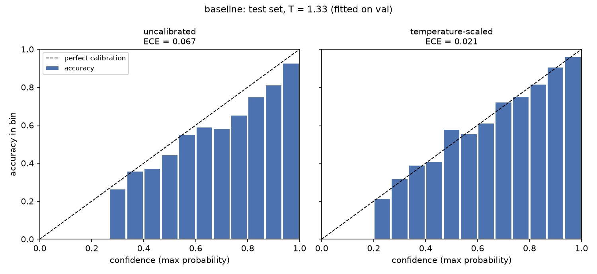
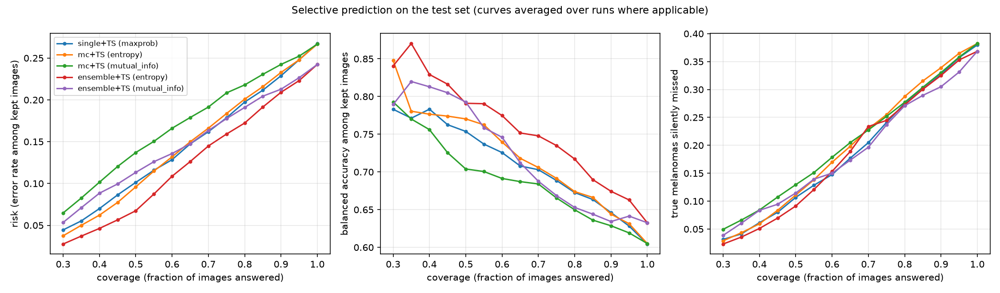
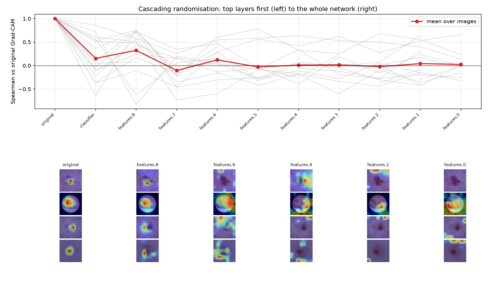
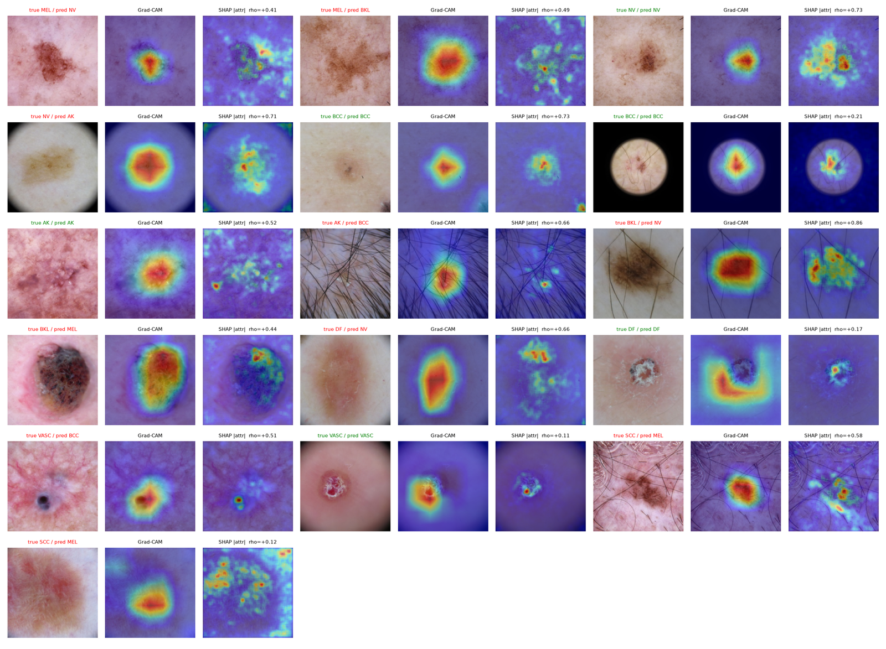
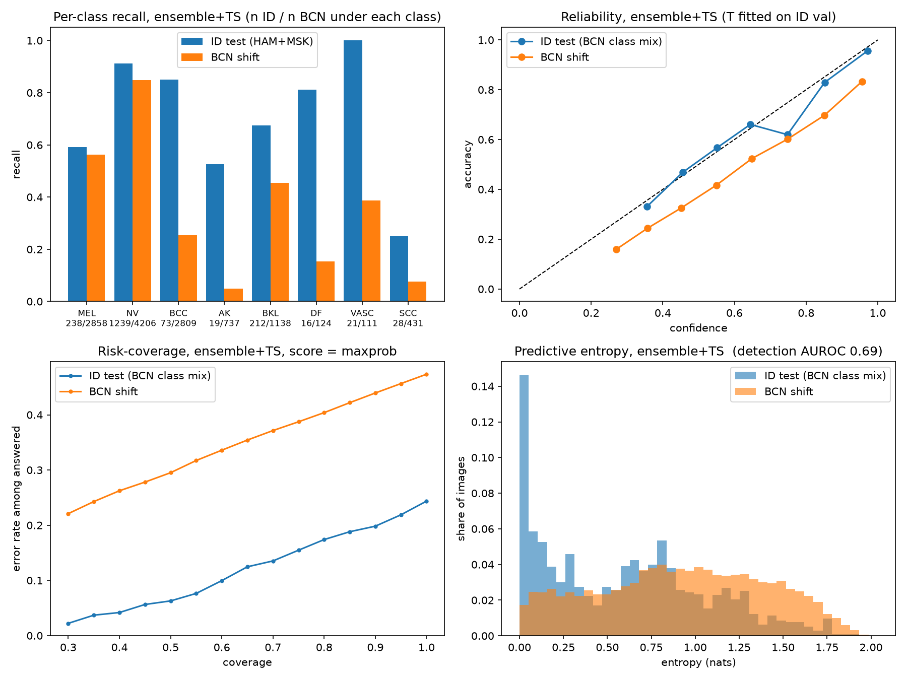
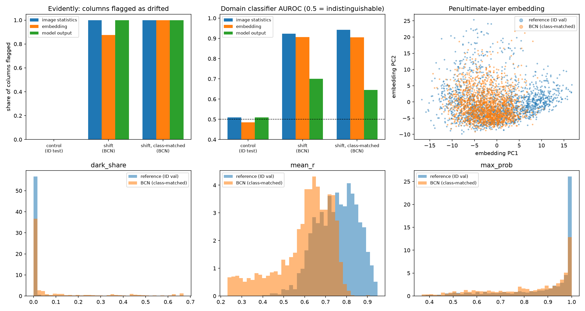
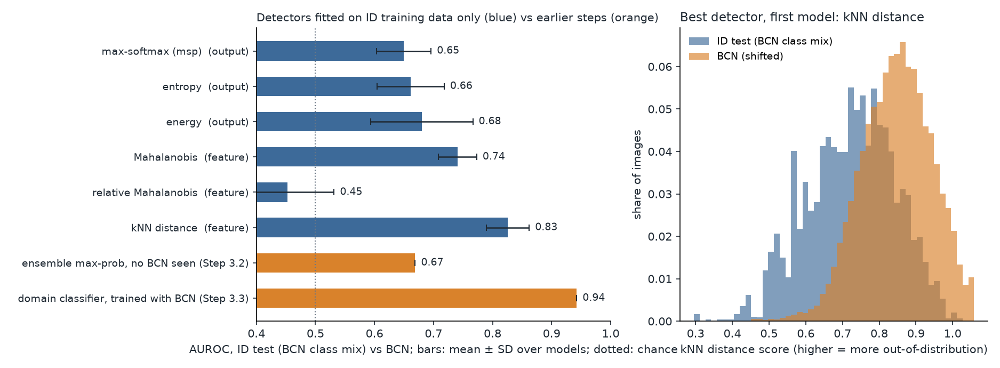

# Reliable Diagnosis Support: Explainability and Uncertainty for Skin-Lesion Classification

[](https://github.com/Orko-Dutta-13/skin-lesion-uncertainty-explainability/actions/workflows/tests.yml) [](LICENSE)

An EfficientNet-B0 classifier for 8-class dermoscopy (ISIC 2019), built around one question:
**when can the model be trusted?** The project combines leakage-safe evaluation, Grad-CAM and SHAP
explanations (with sanity checks), calibrated uncertainty, a measured source shift (HAM10000+MSK to BCN20000)
and label-free drift monitoring. All runs are tracked with MLflow and the pipeline runs in Docker.

> Research code, not a medical device. All numbers below come from real runs (`reports/NOTES.md`
> holds the full log with caveats).

## Key findings

| Question | Answer (test set; 3 seeds unless noted; the leakage ablation is a single run) |
|---|---|
| How much does a naive split inflate results? | Balanced accuracy 0.814 on a random image split vs **0.604 ± 0.013** on a lesion-grouped split (about +0.21). 57.9 % of naive-split test images share a lesion with a training image; 0 % with grouping. |
| Is the model calibrated? | Over-confident (ECE 0.063 ± 0.008). Temperature scaling, fitted on validation only, brings it to **0.020 ± 0.008**. A 3-seed ensemble is already calibrated (ECE 0.015). |
| Which uncertainty method ranks errors best? | The 3-seed ensemble: AURC 0.089 vs 0.111 for a single model (seed SD about 0.006); MC Dropout 0.107 (within noise of single). |
| Does abstention make it safe? | Not by itself. At 80 % coverage, 24 to 29 % of melanomas are still kept but not called melanoma. |
| What happens under a source shift? | Balanced accuracy drops from 0.70 to **0.35** (3-seed ensemble; single model 0.68 to 0.34; HAM+MSK to BCN). Roughly half of that drop (about 0.19) looks attributable to the source shift itself and the rest to BCN simply being a harder set (a model trained with BCN only reaches 0.53 to 0.56 there). This split is an estimate from an imperfectly matched reference, see Limitations. Temperature scaling fitted on in-distribution data does not transfer (ECE 0.131 on BCN). |
| Can the model's own uncertainty flag the shift? | Weakly (AUROC 0.67 to 0.69). Simple image statistics separate the sources much better (AUROC 0.92 to 0.94), and Evidently flags 94 to 100 % of monitored columns on BCN with 0 % on a control. |
| Can a detector flag new-source images one by one, without seeing them in training? | Partly. A kNN distance on the embeddings, fitted on in-distribution training images only, reaches AUROC **0.83 ± 0.04**, vs 0.65 to 0.68 for max-softmax, entropy and energy. It is still not a usable gate: 61 % of in-distribution images are flagged when 95 % of BCN images are. A domain classifier that has seen BCN reaches 0.94. |
| Are the explanations trustworthy? | Grad-CAM passes a weight-randomisation sanity check; Grad-CAM and SHAP agree only moderately (mean Spearman 0.44). They are model explanations, not clinical evidence. |

## Evaluation protocol

- **Grouped splits** (`split`): images of the same lesion never straddle train/val/test.
  ISIC 2019 has no patient ID, so grouping is lesion-level, the closest available unit.
- **Leakage ablation** (`split_naive`): a deliberately leaky random image split.
- **Source shift** (`split_ood`): train/val/test use HAM10000+MSK only (9,226 / 1,845 / 1,846 images);
  `shift_test` is all 12,414 BCN20000 images. Sources are inferred from image size (checked against
  lesion_id prefixes). `split_shift` is an earlier variant kept for reference.
- **Class-mix handling under shift.** BCN has 34 % NV vs 67 % in the in-distribution test set. Accuracy, ECE, NLL and AURC of the
  in-distribution test set are re-weighted to the BCN class mix; balanced accuracy, per-class recall and macro AUROC do not depend on it.
  A reference model trained with BCN data shows how hard BCN is in itself.
- **Metrics.** Balanced accuracy and macro AUROC (imbalance); ECE, NLL, Brier (calibration); AURC / E-AURC and
  coverage curves (selective prediction). The test split is touched only for final configurations.
- **Seeds.** Training is repeated with 3 seeds and tables show mean ± sample SD. Exceptions: the leakage ablation is one run, and the Grad-CAM/SHAP checks and the drift monitor use one model (seed 42).

## Results

### Baseline (grouped split, 3 seeds)
| Metric | Test |
|---|---|
| Balanced accuracy | 0.604 ± 0.013 |
| Macro AUROC | 0.938 ± 0.006 |
| ECE / NLL | 0.063 ± 0.008 / 0.757 ± 0.012 |
| Accuracy | 0.733 |

Weak classes: SCC recall 0.24 to 0.41, AK 0.40 to 0.52. Melanoma recall 0.61 to 0.64.
DF and VASC have about 35 test images each, so their recall is noisy.

### Calibration and uncertainty


| Method (score) | ECE | NLL | AURC | acc @ 80 % coverage |
|---|---|---|---|---|
| single (maxprob) | 0.063 | 0.757 | 0.111 | 0.803 |
| single + temperature scaling | 0.020 | 0.729 | 0.110 | 0.803 |
| MC Dropout | 0.042 | 0.728 | 0.107 | 0.806 |
| 3-seed ensemble | 0.015 | 0.654 | 0.089 | 0.832 |

Temperature scaling fixes calibration but cannot change the ranking of errors. Selective prediction:



### Explanations


Grad-CAM loses its structure once weights are randomised (Spearman to the original map 1.00 to 0.15 after the classifier
alone, about 0.03 with everything randomised; 16 images). SHAP (expected gradients) is more fine-grained and sometimes
fires on hairs or the dermoscope rim; agreement with Grad-CAM is moderate (mean rho 0.44 on 32 images).



### Source shift: HAM+MSK to BCN


| | ID test (BCN mix) | BCN shift | BCN, trained with BCN (reference) |
|---|---|---|---|
| single, balanced accuracy | 0.679 ± 0.003 | 0.341 ± 0.008 | 0.533 ± 0.012 |
| ensemble + TS, balanced accuracy | 0.702 | 0.348 | 0.560 |
| ensemble + TS, ECE / NLL | 0.044 / 0.642 | 0.131 / 1.491 | 0.043 / 0.855 |
| ensemble + TS, AURC | 0.087 | 0.292 | 0.159 |

Recall of BCC (0.85 to 0.25), AK (0.53 to 0.05), DF (0.81 to 0.15) and VASC (1.00 to 0.39) collapses on BCN;
NV and MEL hold up (0.91 to 0.85, 0.59 to 0.56). Even at 50 % coverage the error among answered BCN images is 0.30 vs 0.06 in distribution.

### Drift monitoring (Evidently)


Label-free columns only (8 image statistics, 8 PCA components of the embedding, max-prob, entropy);
reference = 1,800 in-distribution validation images.

| Current data | Columns flagged | Domain-classifier AUROC (image stats / embedding / model output) |
|---|---|---|
| control: ID test images | 0 % | 0.51 / 0.49 / 0.51 |
| BCN | 94 % | 0.92 / 0.91 / 0.70 |
| BCN, class-matched | 100 % | 0.94 / 0.91 / 0.65 |

BCN images are on average darker and less red (mean R about 0.65 vs 0.80). The cause (camera, lighting, skin tone or
resize/crop on different image sizes) was not established.

### Out-of-distribution detection (per image)


Six detectors, all fitted on in-distribution (HAM+MSK) training images only and never shown a BCN image. The score of each
image is compared between in-distribution test images (re-weighted to the BCN class mix) and BCN images. AUROC, mean ± SD over the 3 shift models:

| Detector | Family | AUROC | AUROC without class-mix weights | FPR at 95 % TPR |
|---|---|---|---|---|
| max-softmax | output | 0.650 ± 0.046 | 0.705 | 0.796 ± 0.033 |
| entropy | output | 0.661 ± 0.057 | 0.720 | 0.798 ± 0.030 |
| energy | output | 0.680 ± 0.087 | 0.739 | 0.821 ± 0.055 |
| Mahalanobis (class means, tied covariance) | embedding | 0.741 ± 0.032 | 0.793 | 0.795 ± 0.037 |
| relative Mahalanobis | embedding | 0.453 ± 0.079 | 0.486 | 0.900 ± 0.037 |
| **kNN distance** (k = 10, normalised embedding) | embedding | **0.826 ± 0.036** | 0.812 | **0.606 ± 0.017** |

- kNN is the best detector in all 3 seeds (by 0.06 to 0.14 over Mahalanobis, 0.15 to 0.20 over max-softmax). Mahalanobis beats max-softmax in all 3 seeds, in one of them only by 0.01. Energy varies a lot between seeds (0.59 to 0.76).
- Part of the apparent detection by confidence comes from the class mix: BCN has fewer easy nevus images. Without class-mix weights max-softmax looks better (0.71 vs 0.65); kNN hardly changes (0.81 vs 0.83).
- Distance in the embedding space is a better shift signal than confidence, as Step 3.3 suggested, but the gap to a classifier that has seen BCN (0.94) remains, and FPR at 95 % TPR is still 0.61. As a per-image gate it would reject most good images.
- Relative Mahalanobis scores below chance here (0.45); I did not investigate why and did not tune it.
- This is covariate shift (a new acquisition source). It says nothing about detecting unknown diagnoses; that would need a held-out-class experiment.

## Quickstart

Docker (CPU, no GPU needed; runs the whole pipeline on fake data):
```bash
docker build -t reliable-derm .
docker run --rm reliable-derm          # make smoke-all
docker compose up mlflow               # MLflow UI on http://localhost:5000
```
Local (Linux / macOS):
```bash
pip install -r requirements.txt
make test            # unit tests
make smoke-all       # everything on fake data
# real data: see docs/DATA.md, then
make data train eval-test calibration mc selective train-shift eval-shift shift drift ood   # train* run 3 seeds each
```
Windows (no `make`), in an activated virtual environment, CUDA build of PyTorch installed first (pytorch.org):
```bat
pip install -r requirements.txt
python -m pytest -q
python -m reliable_derm.data.prepare --raw-dir data\raw --out-dir data\processed --resize 256
python -m reliable_derm.train --config configs\baseline.yaml
python -m reliable_derm.evaluate --ckpt runs\baseline\best.pt --split test
python -m reliable_derm.calibration
python -m reliable_derm.selective
python -m reliable_derm.explain.gradcam --ckpt runs\baseline\best.pt --split test --mode correct --per-class 2
python -m reliable_derm.train --config configs\shift.yaml
python -m reliable_derm.shift
python -m reliable_derm.drift --ckpt runs\shift\best.pt
python -m reliable_derm.ood
```
Training takes about 33 s/epoch on an RTX 3070 Laptop GPU.

## Repository layout
```
reliable_derm/   data/ (prepare, splits), train, evaluate, calibration, mc_dropout, uncertainty,
                 selective, shift, drift, ood, explain/ (gradcam, sanity, shap_explain)
configs/         baseline.yaml, shift.yaml
tests/           unit tests (leakage, metrics, uncertainty, explanations, shift, drift)
reports/         NOTES.md (full log), result tables
docs/            DATA.md, ROADMAP.md (future work), figures/
```

## License
The code is released under the MIT License (`LICENSE`). The ISIC 2019 data is not covered by it: it is CC BY-NC 4.0 (non-commercial) and is not included in this repository.

## Data and attribution
Trained and evaluated on the ISIC 2019 training data (CC BY-NC 4.0, non-commercial use). The data is
not redistributed. Attribution and references: `docs/DATA.md` (HAM10000 [1], MSK / ISIC challenge [2], BCN20000 [3]).

## Limitations
- Lesion-level, not patient-level grouping; undetected duplicates across source datasets are possible.
- Sources are inferred from image size, not metadata.
- Single source pair (HAM+MSK to BCN). BCN differs in class mix, acquisition and probably quality; reweighting
  and a BCN-trained reference reduce but do not remove this confound. Bootstrap CIs are image-level and optimistic.
- Rare classes (DF, VASC, SCC) have few test images; their numbers are noisy.
- The ensemble has one instance (3 seeds), so it has no spread estimate.
- Explanation checks use small samples (16 and 32 images, one model) and are not validated against clinical annotations.
- OOD detection was evaluated on one source pair with default settings (k = 10, no tuning). It covers covariate shift only, not unknown diagnoses.
- Drift flags mean "the data changed", not "accuracy will drop by X".
- Not a medical device; research code only.
